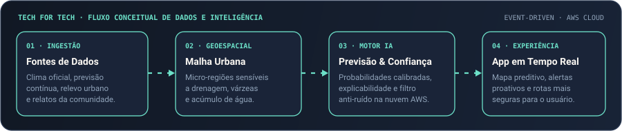

<picture>
  <source media="(prefers-color-scheme: dark)" srcset="https://raw.githubusercontent.com/ALAGOU-AI-TCC/.github/main/assets/hero-dark.svg" />
  <source media="(prefers-color-scheme: light)" srcset="https://raw.githubusercontent.com/ALAGOU-AI-TCC/.github/main/assets/hero-light.svg" />
  
</picture>

 

---

## 💧 AlagouAI? 2.0 — Antecipação antes da chuva cair

Em São Paulo, a maioria das pessoas só descobre que uma via alagou quando já está parada no trânsito ou presa em uma área de risco. O **AlagouAI?** nasceu de um projeto acadêmico e evoluiu para a geração **2.0** com um objetivo claro: **transformar dados climáticos, geográficos e comunitários em decisões simples e antecipadas que protejam pessoas e sua rotina**.

  <a href="https://alagou-ai-web.alagouai.workers.dev"><picture><source media="(prefers-color-scheme: dark)" srcset="https://raw.githubusercontent.com/ALAGOU-AI-TCC/.github/main/assets/card-site-dark.svg" /><source media="(prefers-color-scheme: light)" srcset="https://raw.githubusercontent.com/ALAGOU-AI-TCC/.github/main/assets/card-site-light.svg" /></picture></a>&nbsp;&nbsp;<a href="#tech-for-tech"><picture><source media="(prefers-color-scheme: dark)" srcset="https://raw.githubusercontent.com/ALAGOU-AI-TCC/.github/main/assets/card-cloud-dark.svg" /><source media="(prefers-color-scheme: light)" srcset="https://raw.githubusercontent.com/ALAGOU-AI-TCC/.github/main/assets/card-cloud-light.svg" /></picture></a>

<b>💡 Clique para explorar o que muda na experiência AlagouAI? 2.0</b>

 

| Frente do Produto | O que entregamos para quem vive São Paulo |
| :--- | :--- |
| **⏱ Antecipação de Risco (+24h)** | Leitura contínua das próximas janelas de chuva e saturação do solo para agir antes de sair de casa. |
| **🗺️ Precisão por Micro-Regiões** | Análise sensível à geografia real da cidade — diferenciando topos de morro, várzeas e áreas próximas a córregos. |
| **🔔 Alertas Proativos & Rotas** | Monitoramento de endereços favoritos (casa, trabalho, faculdade) e apoio para escolher trajetos mais seguros. |
| **🛡️ Comunidade Validada** | Relatos em tempo real filtrados por camadas automáticas de consistência para reduzir ruído e falsos alarmes. |

---

## ⚡ Tech for Tech — Como funciona por baixo dos panos

Nossa engenharia equilibra **rigor científico, baixa latência e resiliência em picos de temporal**, sem depender de uma única fonte isolada de informação:

  <picture>
    <source media="(prefers-color-scheme: dark)" srcset="https://raw.githubusercontent.com/ALAGOU-AI-TCC/.github/main/assets/pipeline-dark.svg" />
    <source media="(prefers-color-scheme: light)" srcset="https://raw.githubusercontent.com/ALAGOU-AI-TCC/.github/main/assets/pipeline-light.svg" />
    
  </picture>

<b>🛰️ De onde vêm os dados (as 4 camadas do motor)</b>

 

| Camada de Dados | Papel no Sistema |
| :--- | :--- |
| **Monitoramento Oficial de Clima & Ocorrências** | Consolida histórico de pontos críticos e leituras meteorológicas oficiais de São Paulo para ancorar o modelo na realidade da cidade. |
| **Previsão Meteorológica Contínua** | Alimenta horizontes futuros com intensidade prevista de chuva, volume acumulado e sinais de saturação do solo. |
| **Topografia & Hidrologia Urbana** | Incorpora dados públicos de relevo, elevação e proximidade de córregos para entender onde a água tende a escoar ou acumular. |
| **Validação Comunitária em Campo** | Relatos rápidos enviados por usuários ajudam a confirmar cenários ao vivo e indicar quando uma via volta a ficar transitável. |

<b>☁️ Pilares de Engenharia &amp; Nuvem AWS</b>

 

- **Infraestrutura em Nuvem AWS:** todo o ecossistema está sendo estruturado na **Amazon Web Services (AWS)** com arquitetura modular, orientada a eventos e elasticidade automática para absorver picos repentinos de acesso em dias de temporal.
- **Separação de Domínios:** pipelines de ingestão e modelagem desacoplados dos serviços voltados à experiência do aplicativo mobile e alertas proativos.
- **IA Preditiva Calibrada & Explicável:** foco em probabilidades calibradas (menos falsos alarmes), avaliação contínua de qualidade e tradução clara dos principais fatores por trás de cada alerta em linguagem humana.
- **Camada de Confiança Anti-Ruído:** validação cruzada automática (geolocalização, contexto climático e confirmação entre usuários) antes de qualquer relato ganhar peso no mapa.
- **Mobile First (iOS & Android):** aplicativo multiplataforma desenvolvido com foco em leitura rápida sob estresse, modo claro/escuro e bom desempenho em redes móveis instáveis.

<b>🧭 Propósito — Missão, Visão e Valores</b>

 

- **Missão:** transformar dados climáticos, geográficos e comunitários em decisões simples e antecipadas que protejam pessoas e sua rotina diante de chuvas extremas.
- **Visão:** tornar-se referência em inteligência preventiva para eventos climáticos urbanos no Brasil, começando pela consolidação em São Paulo.
- **Valores:** rigor científico sem "technês" · transparência e explicabilidade · privacidade *by design* · impacto real na vida urbana.

---

## 👥 Equipe Fundadora

Clique em qualquer cartão para conectar no **LinkedIn** e conversar sobre o projeto, testes do Beta ou parcerias:

  <a href="https://www.linkedin.com/in/gabrielpintoo/"><picture><source media="(prefers-color-scheme: dark)" srcset="https://raw.githubusercontent.com/ALAGOU-AI-TCC/.github/main/assets/founder-gabriel-dark.svg" /><source media="(prefers-color-scheme: light)" srcset="https://raw.githubusercontent.com/ALAGOU-AI-TCC/.github/main/assets/founder-gabriel-light.svg" /></picture></a>&nbsp;&nbsp;<a href="https://www.linkedin.com/in/sabrinaluizamelo/"><picture><source media="(prefers-color-scheme: dark)" srcset="https://raw.githubusercontent.com/ALAGOU-AI-TCC/.github/main/assets/founder-sabrina-dark.svg" /><source media="(prefers-color-scheme: light)" srcset="https://raw.githubusercontent.com/ALAGOU-AI-TCC/.github/main/assets/founder-sabrina-light.svg" /></picture></a>&nbsp;&nbsp;<a href="https://www.linkedin.com/in/jhonathanllima/"><picture><source media="(prefers-color-scheme: dark)" srcset="https://raw.githubusercontent.com/ALAGOU-AI-TCC/.github/main/assets/founder-jhonathan-dark.svg" /><source media="(prefers-color-scheme: light)" srcset="https://raw.githubusercontent.com/ALAGOU-AI-TCC/.github/main/assets/founder-jhonathan-light.svg" /></picture></a>

---

## 🌐 English Version

<b>🇬🇧 Click here to read about AlagouAI? 2.0 in English</b>

 

### AlagouAI? 2.0 — Urban Climate Intelligence for São Paulo

**AlagouAI?** combines official weather monitoring, continuous meteorological forecasts, urban terrain hydrology, and community validation to predict flood risks hours ahead — helping people plan safer routes and protect their daily routines across São Paulo, Brazil.

- **Data Fusion:** integrates official municipal climate/incident signals, high-resolution weather forecasts, public topography/drainage layers, and validated crowd reports.
- **Tech for Tech & AWS Cloud:** built on **AWS** with a modular, event-driven architecture designed to scale smoothly during severe storm spikes, pairing geospatial micro-region analysis with calibrated, explainable predictive AI and multi-layer anti-noise trust verification.
- **Live Website:** [alagou-ai-web.alagouai.workers.dev](https://alagou-ai-web.alagouai.workers.dev)
- **Co-Founders:** [Gabriel Pinto](https://www.linkedin.com/in/gabrielpintoo/) · [Sabrina Luiza Melo](https://www.linkedin.com/in/sabrinaluizamelo/) · [Jhonathan Lima](https://www.linkedin.com/in/jhonathanllima/)

