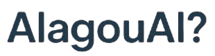
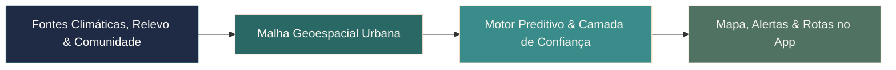

   
  <picture>
    <source media="(prefers-color-scheme: dark)" srcset="https://raw.githubusercontent.com/ALAGOU-AI-TCC/.github/main/assets/logo-icon-white.png" />
    <source media="(prefers-color-scheme: light)" srcset="https://raw.githubusercontent.com/ALAGOU-AI-TCC/.github/main/assets/logo-icon-teal.png" />
    
  </picture>
  &nbsp;&nbsp;&nbsp;
  <picture>
    <source media="(prefers-color-scheme: dark)" srcset="https://raw.githubusercontent.com/ALAGOU-AI-TCC/.github/main/assets/logo-wordmark-white.png" />
    <source media="(prefers-color-scheme: light)" srcset="https://raw.githubusercontent.com/ALAGOU-AI-TCC/.github/main/assets/logo-wordmark-navy.png" />
    
  </picture>

  <h3>Antecipe a chuva. Se proteja em São Paulo.</h3>

  

    <strong>Inteligência climática urbana</strong> que combina monitoramento meteorológico, leitura geoespacial do relevo e validação comunitária para prever riscos de alagamento horas antes — ajudando pessoas a planejar trajetos, cuidar da rotina e chegar em segurança.
  

  

    
    
    
    
  

---

## Sobre o AlagouAI?

Em São Paulo, a maioria das pessoas só descobre que uma via alagou quando já está parada no trânsito ou presa em uma área de risco. O **AlagouAI?** nasceu como um projeto acadêmico e evoluiu para a **geração 2.0** com um objetivo direto: **sair do aviso reativo e entregar inteligência preditiva acessível na palma da mão**.

- **Antecipação de risco (+24h):** leitura contínua de janelas futuras de chuva e vulnerabilidade local.
- **Precisão por micro-regiões:** análise sensível à geografia real da cidade — diferenciando topos de morro, várzeas e áreas próximas a córregos.
- **Alertas proativos & trajetos mais seguros:** monitoramento de endereços favoritos e apoio à decisão antes de sair de casa.
- **Comunidade com alta confiabilidade:** colaboração em tempo real filtrada por camadas de validação para reduzir ruído e falsos alarmes.

---

## Tech for Tech — Como pensamos a engenharia

Nossa arquitetura foi desenhada para equilibrar **rigor científico, baixa latência e resiliência em picos de temporal**, sem depender de uma única fonte isolada de informação.

### De onde vêm os dados

| Camada de Dados | Papel no Sistema |
| :--- | :--- |
| **Monitoramento Oficial de Clima & Ocorrências** | Consolida histórico de eventos críticos e leituras meteorológicas contínuas da capital paulista para ancorar o contexto real da cidade. |
| **Previsão Meteorológica Contínua** | Alimenta horizontes futuros com projeções de intensidade de chuva, volume acumulado e sinais de saturação do solo. |
| **Topografia & Hidrologia Urbana** | Incorpora dados públicos de relevo, elevação e rede de drenagem natural para entender onde a água tende a escoar ou acumular. |
| **Sinal Comunitário Validado** | Relatos rápidos enviados por pessoas em campo ajudam a confirmar o cenário ao vivo e sinalizar quando a via volta a ficar transitável. |

### Pilares arquiteturais

- **Infraestrutura em Nuvem (AWS):** estamos construindo o ecossistema em nuvem **AWS**, priorizando serviços gerenciados, arquitetura desacoplada orientada a eventos e elasticidade automática para suportar picos repentinos de demanda durante tempestades.
- **Grade Geoespacial Contínua:** em vez de alertas genéricos por zonas gigantes, estruturamos a cidade em células geográficas uniformes que cruzam histórico, relevo e chuva em tempo real.
- **IA Preditiva Calibrada & Explicável:** nossos modelos combinam variáveis climáticas e espaciais com foco em **calibração de probabilidade** (menos falsos alarmes), avaliação contínua de qualidade e tradução clara dos principais fatores por trás de cada alerta.
- **Camada de Confiança Anti-Ruído:** todo relato comunitário passa por verificações automáticas de consistência geográfica, contexto climático e confirmação colaborativa antes de ganhar peso no mapa.
- **Experiência Mobile First:** novo aplicativo multiplataforma (iOS & Android) projetado do zero para leitura imediata sob estresse, modo claro/escuro e bom desempenho mesmo em conexões móveis instáveis.

---

## Propósito

| | |
| :--- | :--- |
| **Missão** | Transformar dados climáticos, geográficos e comunitários em decisões simples e antecipadas que protejam pessoas e sua rotina diante de chuvas extremas. |
| **Visão** | Tornar-se a referência em inteligência preventiva para eventos climáticos urbanos no Brasil, começando pela consolidação em São Paulo. |
| **Valores** | Rigor científico sem "technês" • Transparência e explicabilidade • Privacidade by design • Impacto real na vida urbana. |

---

## Equipe Fundadora

| | | |
| :---: | :---: | :---: |
| **Gabriel Pinto** Co-Founder <a href="https://www.linkedin.com/in/gabrielpintoo/">LinkedIn ↗</a> | **Sabrina Luiza Melo** Co-Founder <a href="https://www.linkedin.com/in/sabrinaluizamelo/">LinkedIn ↗</a> | **Jhonathan Lima** Co-Founder <a href="https://www.linkedin.com/in/jhonathanllima/">LinkedIn ↗</a> |

---

  
    Conheça mais sobre o projeto e acompanhe o Beta em
    <a href="https://alagou-ai-web.alagouai.workers.dev"><strong>alagou-ai-web.alagouai.workers.dev</strong></a>
  

